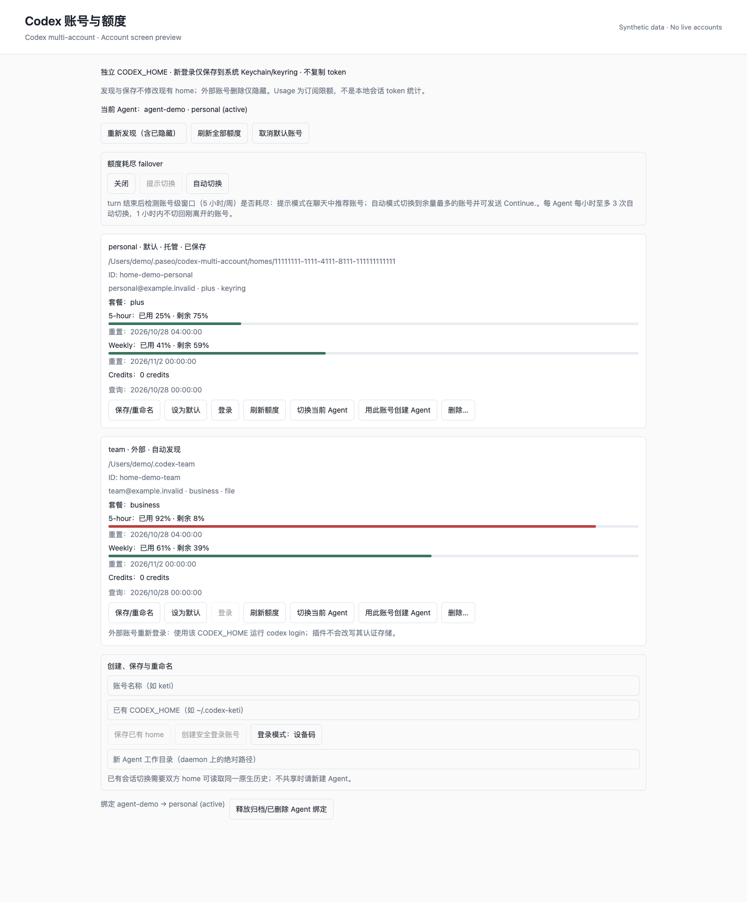

# paseo-codex-multi-account

Manage multiple Codex and ChatGPT subscription accounts in Paseo. Keep each account in a separate `CODEX_HOME`, create accounts with secure sign-in, select or switch accounts per agent, and view subscription usage. The plugin can suggest or automatically switch accounts when usage runs out.

v0.2.0 supports Paseo daemon and client versions `>=0.14.0-beta.1 <0.18.0`. Nine published versions passed compatibility checks, including 0.15.4, 0.16.2, and 0.17.1. [Compatibility guide](docs/COMPATIBILITY.md)

[简体中文 README](README.zh-CN.md) · [English overview](OVERVIEW.md) · [中文市场介绍](OVERVIEW.zh-CN.md)



The preview renders the account screen in a read-only host using synthetic accounts, email addresses, paths, and usage.

## Accounts and usage

- Discover `~/.codex`, `~/.codex-*`, `~/.codex_*`, and the daemon's `CODEX_HOME`. Save other existing directories by path. Aliases resolve to the same canonical path.
- Reuse existing homes such as `~/.codex-keti`. The plugin reads existing authentication and configuration in place and leaves both intact, including any existing plaintext `auth.json`.
- Create a managed home and sign in with the official `codex app-server` using a device code or a local browser. New sign-ins require strict direct keyring storage and fail if that storage is unavailable. Sign-in links and device codes stay in memory. Use **Close / cancel sign-in** to cancel, or **View sign-in** to reopen the dialog after leaving the page.
- Choose a default for new agents, create an agent with a specific account, or switch an idle agent. An existing binding persists when the default changes. Account selection fails if the target is missing, expired, changed, or lacks a stable ChatGPT account ID, or if a previous switch is unconfirmed.
- View subscription usage globally or for the current session through Paseo's Usage Source. The account screen shows reported usage windows, model-specific limits, credits, reset times, and errors per home. The Usage Source groups homes with the same ChatGPT identity. Usage figures describe subscription limits, separate from session token counts and API charges.
- Remove an account from the list, or explicitly sign out and permanently delete a managed home. External homes are read-only to the plugin.

## Install locally

Check both the daemon and client versions before installing. The plugin requires Node.js 22.12 or later and a separately installed official Codex CLI. Managed sign-in requires macOS Keychain or Linux Secret Service with `secret-tool` and the direct keyring backend. Linux keyring has yet to be verified on a real machine. Windows and the encrypted `secrets` backend are unsupported.

```bash
cd /absolute/path/to/paseo-codex-multi-account
npm ci --ignore-scripts
npm run check
paseo plugin install "$PWD"
paseo plugin ls
```

The plugin runs as trusted, unsandboxed code with the daemon user's file and keyring access. The UI runs in the Paseo client. Enable third-party plugins in Paseo settings if needed. After making local changes, reload without restarting the daemon.

```bash
paseo plugin reload paseo-codex-multi-account
```

GitHub source installation uses the manifest's `npm ci --omit=dev --ignore-scripts` preparation command. The committed shrinkwrap pins the only production dependency, `@iarna/toml`. Paseo provides the SDK and React. Install one instance of the plugin because its registry assumes a single writer.

For direct installation, enter this Git source in desktop Paseo under **Settings → Plugins → Plugin Sources**.

```text
git:ketitongxue/paseo-codex-multi-account
```

Direct installation pins the Git revision at install time. Marketplace distribution requires official review of a pinned revision, and npm distribution requires a separate manifest. [GitHub releases](https://github.com/ketitongxue/paseo-codex-multi-account/releases) · [Publishing guide in Chinese](docs/PUBLISHING.md)

## Manage accounts

Open **Codex Accounts & Usage** from the sidebar.

1. Select **Save / rename** to name a discovered home. To add another home, enter its path and name, then select **Save existing home**.
2. Select **Create account with secure sign-in** to sign in using a device code. You can also choose local-browser sign-in, which completes its localhost callback on the computer running the daemon. Device-code sign-in can finish on another device.
3. Select **Set as default** to use that account for new agents. To create an agent directly, enter an absolute working directory on the daemon host and select **Create agent with this account**.
4. In a chat, run `/codex-accounts` and select **Switch current agent**, or run `/codex-account keti`. If names overlap, use the account ID shown in the account screen.
5. Before removing an account, clear it as the default and switch any agents bound to it. You can release bindings for archived or deleted agents. If such an agent is opened again, explicitly select an account.

By default, removal forgets or hides the account and preserves credentials and native history. **Rediscover accounts (including hidden)** can recover hidden external homes. Record a managed home's path before forgetting it because those homes are outside automatic discovery. To permanently delete a managed home, choose **Also sign out and delete the managed home** in the removal dialog. Uninstalling the plugin preserves account data.

To sign in again to an external account, use the original CLI. Its credential storage follows that home's Codex configuration.

```bash
CODEX_HOME="$HOME/.codex-keti" codex login
```

### How switching works

Both homes must be able to read the same native Codex thread before an existing agent can switch. If the target home cannot read the thread, create a new agent or configure shared history yourself. The plugin leaves session files and databases in place.

Switching uses `agent.reload()` and starts no model turn. The `active` binding status confirms the reload and the target session-open environment. Paseo may start the native process later, so the binding status does not verify native process authentication. Avoid sending messages from another client while switching because Paseo checks that the agent is idle and reloads it as separate operations. If rollback cannot be confirmed, the binding is marked `unconfirmed` and the next open requires explicit account selection. The same rule applies if a switch fails for an older agent whose previous account is unknown.

The plugin leaves Pi configuration and provider launch commands intact. A custom Codex provider command, API key, or custom endpoint that overrides subscription authentication prevents a selected account from starting.

### Select an account when creating an agent

Use the account name or ID in the `codex/account` creation label. The ID is preferred when names may overlap.

```ts
await paseo.agents.create({
  cwd: "/absolute/project",
  config: { provider: "codex" },
  labels: { "codex/account": "keti" },
});
```

```bash
paseo run --provider codex --cwd /absolute/project \
  --label codex/account=keti "Review this project"
# Or set a one-time creation hint. The plugin saves the binding and removes the hint.
paseo run --provider codex --cwd /absolute/project \
  --env PASEO_CODEX_ACCOUNT=keti "Review this project"
```

Selection takes the first applicable choice in this order. An in-progress switch, a saved binding, a creation environment hint, a creation label, and finally the default for new agents. To switch an existing agent, use the reload-based controls.

Interactive Codex agents can call `codex_accounts` for account IDs, names, plan details, and optional usage, then use the label to create a subagent with a specific account. Tool responses omit tokens. Codex agents without a selected account keep their original `CODEX_HOME`. Pi and other providers keep their original environments.

### Usage limit failover

In **Usage limit failover**, choose **Off**, **Suggest a switch** (the default), or **Auto-switch**. After a turn ends, failover checks whether a bound account's reported account-wide five-hour or weekly window is at 100% before reset. Model-specific limits, feature windows, windows with no reset time, and windows past their reset time do not trigger failover. A failed turn refreshes usage subject to error backoff. A completed turn reads the cache.

The default mode posts a chat notice recommending the eligible signed-in account with the most remaining usage. Auto-switch uses the same confirmed reload and rollback path as a manual switch and can send `Continue.` to resume an interrupted task. An agent can auto-switch up to three times per hour and cannot return to the account it just left for one hour. Rate limiting or a failed switch falls back to a notice. Notices are held in daemon memory and posting a notice is independent of whether switching succeeds.

## Usage requests and data

- Credentials stay in memory. Usage sends requests only to `https://chatgpt.com/backend-api/wham/usage`, without redirects, model requests, or refresh-token exchanges.
- Global discovery includes expired logins. Session discovery reads only the session's home and skips lifecycle hooks.
- Credentials are reread and the identity and fingerprint are checked before and after the request. Usage is cached in memory for up to five minutes, bounded by access-token expiry. At most two requests run concurrently, and requests for the same account are coalesced. Manual refresh respects error backoff and `Retry-After`.
- Usage reports actionable errors for expired credentials, HTTP 401/403, network failure, and unexpected responses. Window labels use reported durations. Unexpected data leaves usage unavailable and cached usage stays tied to its original identity.
- Paseo's built-in Codex Usage Source remains available alongside this plugin's multi-account source.

```text
$PASEO_HOME/codex-multi-account/    # Defaults to ~/.paseo/codex-multi-account/
  accounts.json                   # Names, paths, default, bindings, hide and release markers
  homes/<uuid>/config.toml        # Strict keyring configuration for managed accounts
```

Directories use mode `0700` and metadata uses `0600`. Codex stores managed account credentials in the OS keyring namespace for that home. The plugin metadata contains no tokens or encryption keys. Codex can still write its own logs and session history to the home.

Set `PASEO_CODEX_BINARY=/absolute/path/to/codex` to use a particular Codex executable. The value is a path to one executable.

## Verify

```bash
npm run check                  # Types, compatibility, lint, and tests
npm run smoke:homes            # Discover local homes without printing tokens or email addresses
npm run smoke:homes -- --usage # Optional live read-only usage GET
npm run smoke:codex            # Optional real CLI protocol check with a temporary HOME
npm run screenshot             # Render the synthetic preview with installed Chrome
npm pack                       # Build the installable package
```

Tests use temporary HOME and PASEO_HOME directories, synthetic JWTs, and a fake Codex app-server. The check command also verifies SDK types, compiler output, and plugin subprocess behavior across nine published Paseo versions. Interactive OAuth, model turns, and production conversation switching require separate live validation.

[Research in Chinese](docs/RESEARCH.md) · [Validation records in Chinese](docs/VALIDATION.md) · [Security](SECURITY.md)
