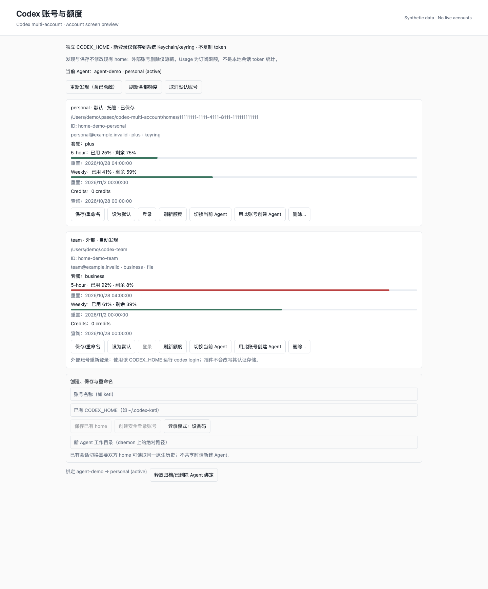

# paseo-codex-multi-account

面向 **Paseo daemon 与客户端 v0.14.0-beta.1** 的 Codex / ChatGPT 多账号插件。独立 `CODEX_HOME`、安全登录、账号保存/删除、逐 Agent 选择/切换，以及订阅额度 Usage Source。manifest 允许 0.14 系列，后续版本尚未验证。

[English overview](OVERVIEW.md) · [中文市场介绍](OVERVIEW.zh-CN.md) · [发布准备与审核流程](docs/PUBLISHING.md)



图片由实际账号组件在只读预览宿主中渲染，账号、邮箱、路径与额度均为合成数据；不是生产 OAuth 或聊天切换的验收截图。

## 功能与边界

- 自动发现 `~/.codex`、`~/.codex-*`、`~/.codex_*`、daemon 的 `CODEX_HOME`；其他目录可手动保存。别名路径按 canonical path 去重。
- 复用 `~/.codex-keti` 等已有目录，**不复制 auth.json，不改其配置、不搬运 token**。
- 新账号由官方 `codex app-server` 进行设备码或本机浏览器登录；严格 `keyring` + `direct`，不能使用安全存储时失败，**不使用会回落明文的 auto 模式**。登录链接/设备码仅在内存，关闭弹窗可取消；离开页面后可用“查看登录”重新打开。
- 保存路径与名称、设置新 Agent 的默认账号、删除/隐藏条目；托管账号可明确确认后同时注销并删除自己的 home。外部 home 永不通过插件注销或删除。
- 每个 Agent 的账号绑定持久化；默认值变化不会影响已有 Agent。目标丢失、身份改变、缺少稳定 ChatGPT account ID 或切换未确认时拒绝启动，不能静默回落其他账号。
- 原生 Usage Source 提供全局账号额度及当前会话额度；插件页面按 home 展示 5 小时/周/其他明确窗口、模型专项限额、credits、重置时间和错误。相同 ChatGPT 身份的多个 home 在该 Usage Source 中合并。
- **不读写 Pi 配置/认证文件，不改 provider command，不安装全局启动器。**

### 需要知道

- Usage 是 ChatGPT **订阅限额**，不是会话 token 统计或 API 账单。窗口名称只依据服务端明确的时长；未知不显示成 0%。接口非公开稳定承诺，变化时显示错误而非估算。
- 现有 `auth.json` 可能本来就是明文。插件只读取它；不会自动迁移、删除或声称已经加密。新登录只允许在插件创建的 keyring-only home 中进行。
- **独立 home 不一定共享会话历史。** 已有会话切换前，官方 CLI 必须能在目标 home 读取同一原生 thread。不可见时拒绝切换，请用目标账号新建 Agent，或由你自行配置共享历史。插件不复制历史或数据库、不以空白会话替代原上下文。
- 切换通过 `agent.reload()` 重开会话，不发起模型 turn。`active` 表示 reload 成功且目标 session-open 环境已确认，并非独立的进程启动认证回执。Paseo 可能懒启动原生进程。
- Paseo 没有原子的“检查空闲并重载”。切换时不要从另一个客户端同时发消息。失败尝试恢复原绑定；无法确认回退时标记 `unconfirmed`，下一次打开会拒绝。原账号未知的旧 Agent 也可以显式切换，但失败时不能猜测回退身份。
- daemon 支持 macOS Keychain，以及 Linux Secret Service（需 `secret-tool`，Codex direct keyring 后端）。Windows 和 Codex encrypted `secrets` keyring 后端尚未验证/支持；失败不回落文件。客户端 UI 使用 React Native，可在 Paseo 桌面、Web、手机显示。
- 不要同时使用另一个切换器改写 Codex 启动命令。选中账号时发现 provider 自定义 command、API-key/自定义 endpoint 覆盖会拒绝启动，而不会替你改配置。

## 本地安装

**先确认目标 daemon 版本，不只是 CLI 版本。** 本项目不会升级或重启你的生产 daemon。

```bash
cd /absolute/path/to/paseo-codex-multi-account
npm ci --ignore-scripts
npm run check
# 确认目标 daemon 已为 v0.14.0-beta.1+，并且你信任插件后执行：
paseo plugin install "$PWD"
paseo plugin ls
```

插件是受信任、**无沙箱**代码，可访问 daemon 用户的文件和 Keychain；UI 运行在 Paseo 客户端内。若 daemon 尚未启用第三方插件，需由你在 Paseo 设置中明确启用；本项目不替你更改该开关。开发后热重载：

```bash
paseo plugin reload paseo-codex-multi-account
```

无需重启主 daemon。当前分发方案为 GitHub 源码安装；manifest 的 argv preparation 使用 `npm ci --omit=dev --ignore-scripts`，从随仓库提交的 `npm-shrinkwrap.json` 安装唯一运行时依赖 `@iarna/toml`。SDK、React 等由 Paseo 提供。只安装**一个**该插件实例，数据根是单写者注册表。

公开源码：[ketitongxue/paseo-codex-multi-account](https://github.com/ketitongxue/paseo-codex-multi-account)。市场收录需官方审核，不能把 GitHub 发布或提交 Issue 当作已上架。npm 分发还需单独准备对应 manifest，参见发布文档。

市场批准前，也可在桌面端目标主机的「设置 → 插件 → 插件来源」填写以下直接 Git 来源（需信任源码并启用插件）：

```text
git:ketitongxue/paseo-codex-multi-account
```

这不是市场安装 ID。首次安装会固定当时的 Git revision；发布版本与验证信息见 [Releases](https://github.com/ketitongxue/paseo-codex-multi-account/releases)。

## 使用

侧边栏 **Codex 账号与额度**：

1. 自动发现已有 homes；填写名称后“保存/重命名”。保存其他目录可填写 `~/.codex-keti` 或绝对路径。
2. “创建安全登录账号”，完成设备码授权；也可先切换为本机浏览器模式。浏览器模式需要在 **daemon 所在电脑** 完成 localhost 回调，远程手机使用设备码更合适。
3. 设为默认，或填写 daemon 上的工作目录并选择“用此账号创建 Agent”。
4. 在目标聊天输入 `/codex-accounts` 打开带 Agent 上下文的管理页，选择“切换当前 Agent”；或输入 `/codex-account keti`。名称不唯一时使用页面中的稳定 ID。
5. 删除前取消默认、切走其 Agent；已归档/已删除 Agent 可“释放绑定”。释放会留下非秘密拒绝回落标记；若未来再用该 Agent，必须显式重选账号。

默认删除是**忘记/隐藏**。重新发现可以恢复被隐藏的外部目录。托管目录不在自动扫描路径中：忘记前记下路径；需要彻底删除应在删除确认框明确选择“注销并永久删除托管 home”。插件卸载不会自动删除账号数据。

外部 home 的重新认证由你使用原 CLI 完成，例如：

```bash
CODEX_HOME="$HOME/.codex-keti" codex login
```

这条命令的存储模式由该 home 自己的 Codex 配置决定；不是插件的安全登录流程。

### Agent 指定账号

Paseo SDK 的创建 label（名称或 ID；推荐 ID）：

```ts
await paseo.agents.create({
  cwd: "/absolute/project",
  config: { provider: "codex" },
  labels: { "codex/account": "keti" },
});
```

CLI：

```bash
paseo run --provider codex --cwd /absolute/project \
  --label codex/account=keti "检查这个项目"
# 或使用一次性的创建环境提示，插件会保存绑定并移除提示：
paseo run --provider codex --cwd /absolute/project \
  --env PASEO_CODEX_ACCOUNT=keti "检查这个项目"
```

选择顺序：显式进行中的切换 > 已保存绑定 > 创建环境提示 > label > 仅对新 Agent 生效的默认值。不要通过修改已有 Agent label 代替重载切换。

交互 Codex Agent 可调用 `codex_accounts` 工具查看非秘密账号 ID/名称/套餐及可选额度，再用 label 创建指定账号的子 Agent。该工具不返回 token。未选择账号的 Codex Agent 不被改写 `CODEX_HOME`；其他 provider（包括 Pi）不被 hook 改写。

## 额度查询

- 凭据只驻内存；只请求固定的 `https://chatgpt.com/backend-api/wham/usage`，禁止重定向，不发模型请求，不兑换 refresh token。
- 全局发现包括过期登录；会话发现只读该会话的 home，不扫描默认/其他账号，也不运行生命周期 hook。
- 重新读取凭据并在请求前后核对身份/指纹。内存缓存最多 5 分钟且不跨越 access token 过期时间，最多两个并发、同账号合并请求；手动刷新也遵守错误退避与 `Retry-After`。
- 401/403、过期、网络错误、HTML/格式变化分别显示可操作错误。不会把一个身份的旧额度给另一个身份。
- Paseo 自带的 Codex Usage Source 不被禁用，因此宿主 Usage 中可能同时看到原生 Codex 来源与本插件来源；本插件覆盖所有发现 homes 和 keyring 登录。

## 数据与配置

```text
$PASEO_HOME/codex-multi-account/      # 默认 ~/.paseo/codex-multi-account/
  accounts.json                     # 名称、路径、默认值、绑定、隐藏/释放标记；无 token
  homes/<uuid>/config.toml          # 仅托管账号，严格 keyring 配置
```

目录 `0700`、元数据 `0600`。账号凭据由官方 Codex 存在对应 home 的 OS keyring 命名空间中；插件没有自己的 token 仓库或加密密钥文件。会话运行后官方 CLI 可以在托管 home 写自己的历史/日志，这不是文件系统沙箱。

可选环境：`PASEO_CODEX_BINARY=/absolute/path/to/codex`（单一可执行文件，不是 shell 字符串）。

## 验证

```bash
npm run check                  # 类型、lint、合成凭据/进程/UI/真实 beta 插件运行时测试
npm run smoke:homes            # 本机 homes 只读发现；不打印 token/email
npm run smoke:homes -- --usage # 可选：真实只读额度 GET；无模型 turn
npm run smoke:codex            # 可选：真实 CLI 的临时 HOME / ephemeral 协议验证；不访问原凭据
npm run screenshot             # 可选：已安装 Chrome；只渲染合成数据预览，不访问用户账号
npm pack                       # 生成可安装发布包
```

测试使用临时 HOME/PASEO_HOME、合成 JWT 和假 Codex app-server；真实 Paseo **v0.14.0-beta.1** 编译器与插件子进程运行时也包含在测试内。没有替你执行真实 OAuth 登录、真实模型 turn 或生产聊天切换。

研究与计划：[docs/RESEARCH.md](docs/RESEARCH.md)；验证记录：[docs/VALIDATION.md](docs/VALIDATION.md)；安全边界：[SECURITY.md](SECURITY.md)；市场发布：[docs/PUBLISHING.md](docs/PUBLISHING.md)。
